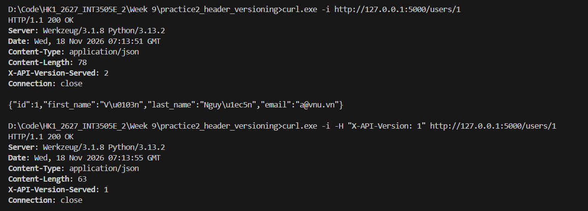
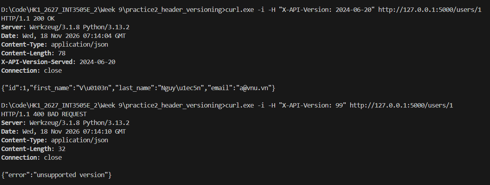

# Week 9 — API Versioning với Flask

Tài liệu này trình bày hai bài thực hành trong Week 9. Hai bài là hai ứng dụng demo độc lập, cùng dùng dữ liệu user mẫu nhưng minh họa hai cách chọn phiên bản API khác nhau.

## Image 1 — URI Path Versioning với Flask Blueprint



### Mục tiêu

Mỗi phiên bản có URL riêng. Blueprint v1 giữ schema cũ với trường full_name; Blueprint v2 trả first_name và last_name riêng.

| Method | Endpoint | Phiên bản | Kết quả |
|---|---|---|---|
| GET | /api/v1/users/{id} | v1 | id, full_name, email |
| GET | /api/v2/users/{id} | v2 | id, first_name, last_name, email |
| POST | /api/v2/users | v2 | Tạo user, trả 201 và Location |

Dữ liệu chung nằm ở blueprints/users_data.py. Khi gọi API v1, response có Sunset và Link tới resource tương ứng ở v2. OpenAPI spec nằm tại openapi.yaml.

Chạy Practice 1 từ thư mục Week 9:

```powershell
.\.venv\Scripts\python.exe -m app
```

Thử hai schema:

```powershell
curl.exe -i http://127.0.0.1:5000/api/v1/users/1
curl.exe -i http://127.0.0.1:5000/api/v2/users/1
```

V1 trả dạng JSON:

```json
{"id":1,"full_name":"Văn Nguyễn","email":"a@vnu.vn"}
```

V2 trả dạng JSON:

```json
{"id":1,"first_name":"Văn","last_name":"Nguyễn","email":"a@vnu.vn"}
```

Tạo user trên v2:

```powershell
curl.exe -i -X POST http://127.0.0.1:5000/api/v2/users -H "Content-Type: application/json" -d '{"first_name":"Minh","last_name":"Lê","email":"minh@vnu.vn"}'
```

## Image 2 — Header Versioning với decorator



### Mục tiêu

Tất cả phiên bản dùng cùng URL GET /users/{id}. Client chọn schema bằng request header X-API-Version. Response hợp lệ cho biết phiên bản thực sự được dùng qua X-API-Version-Served.

| X-API-Version | Schema được trả |
|---|---|
| Không gửi | v2, phiên bản ổn định mới nhất |
| 1 | full_name |
| 2 | first_name, last_name |
| 2024-06-20 | Schema hiện tại của v2 |
| Giá trị khác | HTTP 400, không fallback |

Decorator api_version kiểm tra header trước khi gọi endpoint. Version không được hỗ trợ không chạy endpoint và không có X-API-Version-Served.

Ứng dụng và test của Practice 2 được đặt riêng tại practice2_header_versioning/ để không ghi đè bài Blueprint ở Image 1. Chạy từ thư mục Week 9:

```powershell
.\.venv\Scripts\python.exe -m practice2_header_versioning.app
```

Thử default v2, v1, dated version và version không hỗ trợ:

```powershell
curl.exe -i http://127.0.0.1:5000/users/1
curl.exe -i -H "X-API-Version: 1" http://127.0.0.1:5000/users/1
curl.exe -i -H "X-API-Version: 2" http://127.0.0.1:5000/users/1
curl.exe -i -H "X-API-Version: 2024-06-20" http://127.0.0.1:5000/users/1
curl.exe -i -H "X-API-Version: 99" http://127.0.0.1:5000/users/1
```

Lệnh cuối trả HTTP 400 với body {"error":"unsupported version"}. Chạy từng ứng dụng riêng; cả hai dùng port 5000.
